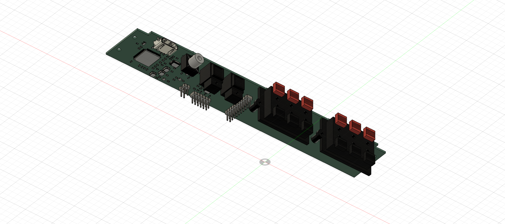

# Open Cinema Hardware

Editable hardware for [Open Cinema](https://github.com/k3rnL/open-cinema). The [resources repository](https://github.com/k3rnL/open-cinema-resources) holds searchable knowledge and decision history.

## Current work: A12 routed ARC prototype

[Open A12](boards/rear-io-A12/README.md). ADV7511 ARC candidate → CS8416 four-source selector → three-pair LVDS link → Raspberry Pi. The Pi decodes/processes audio and sends output over USB to the amplifier. Optical ×2, coax, HDMI and six speaker pairs remain on one horizontal board.

- [Editable KiCad project](boards/rear-io-A12/rear-io-A12.kicad_pro) and [routed PCB](boards/rear-io-A12/rear-io-A12.kicad_pcb)
- [Schematic PDF](boards/rear-io-A12/exports/rear-io-A12-schematic.pdf)
- [Rigid STEP](boards/rear-io-A12/exports/rear-io-A12-rigid.step) / [Fusion archive](boards/rear-io-A12/exports/rear-io-A12-rigid.f3d)
- [Manufacturing review files](boards/rear-io-A12/manufacturing-review/README.md), [sourcing](boards/rear-io-A12/sourcing.md), [requirements](boards/rear-io-A12/requirements.md), [verification](boards/rear-io-A12/verification.md)

**Routing is complete: 0 ERC violations, 0 DRC violations and 0 unrouted connections. Manufacturing release remains on hold.** ARC-only/CEC startup, DD+ payload preservation and Pi capture have not been demonstrated; ADV7511 eligible supply and horizontal KLS speaker-clip current rating remain unresolved. The package includes Gerbers, drills, BOM/CPL, stackup and a [qualification plan](boards/rear-io-A12/bring-up.md); it is not an approved order.

The [accepted ARC scope](docs/arc-v1-requirements.md) defers eARC/lossless return audio while retaining DD+ Atmos as a validation target. A12 does not claim those tests passed.

## Mechanical integration

A12 preserves the 228 ×39.8 ×1.6 mm PCB, connector positions and four Ø3 holes at installation x±110 mm, depths 12/30 mm. Its rigid files contain one component with 162 solids and no child components; both reimports match. No owner backplate, L brackets or mains circuit is included.

The latest owner opening is 250 ×51 mm. Assembled clearance, airflow, cable access, tolerances and loaded thermal/EMI behavior remain to be checked. Exports retain the component-down installation datum, nominal z 67 mm. Existing owner CAD and the linked `rear-io-A5-assembly` cloud document were not saved or overwritten. Git publication does not update Fusion links automatically.

## Previous revisions

- [A11 ARC electrical study](boards/rear-io-A11/README.md): historical unrouted schematic/placement.
- [A10 electrical draft](boards/rear-io-A10/README.md): historical mux/LVDS design, HDMI unwired.
- [A9 mechanical baseline](docs/pcb-only-assembly-A9.md), [A8 horizontal study](docs/horizontal-assembly-A8.md).
- [Original mechanical KiCad project](boards/rear-io/rear-io.kicad_pro): manual edits preserved.
- [A7 vertical design in history](https://github.com/k3rnL/open-cinema-hardware/tree/eae54aa79c94255bdad5aaae5bf087d2b4166b0e).

JLCPCB is preferred; Global Sourcing/pre-order and external suppliers are allowed. No purchase or supplier contact was made. The saved A12 board owns routing; do not regenerate over manual work. [Checks and export reproduction](boards/rear-io-A12/verification.md).

No project hardware license has been selected. KiCad assets retain their [attribution/license](docs/sources/README.md).
