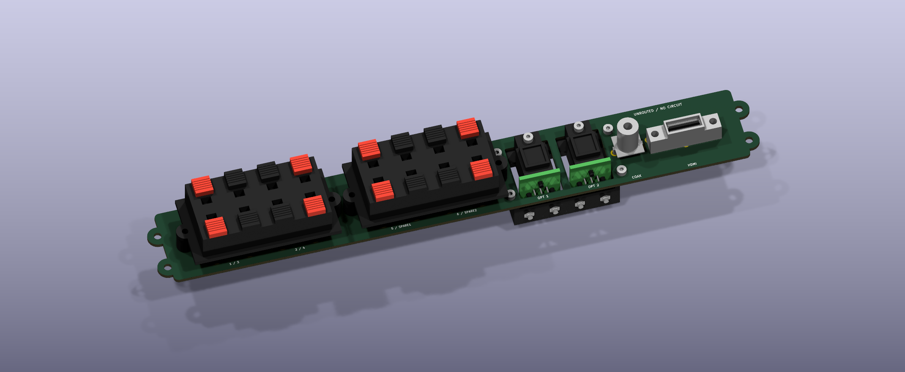
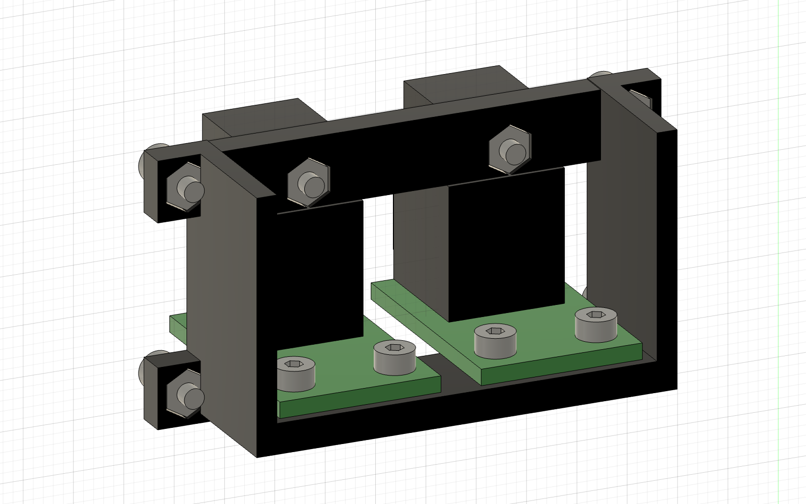

# Open Cinema Hardware

Editable hardware for [Open Cinema](https://github.com/k3rnL/open-cinema). The [resources repository](https://github.com/k3rnL/open-cinema-resources) owns searchable knowledge and decision history.

## Rear connector fit study — A7

A7 selects two **Cliff FE6930** blocks: six working speaker pairs plus two spares, rated 7 A by Cliff. The bolted optical cradle, vertical PCB, 220 ×35 mm R5 opening and four Ø3 alignment holes are retained. New **single-component Fusion integration files** keep the complete assembly together.

## Use these files for enclosure placement

- **[A7 rigid Fusion file (.f3d)](boards/rear-io/exports/rear-io-A7-rigid.f3d)**
- **[A7 rigid STEP](boards/rear-io/exports/rear-io-A7-rigid.step)**
- [Import/joint instructions and optical mounting](docs/assembly-and-optical-support-A7.md)

These files contain one component with 135 solid bodies. A rigid joint to an alignment hole was tested to move all 135 together. Disable **Ground to Parent** on the inserted unit if Fusion enables it. The [raw KiCad STEP](boards/rear-io/exports/rear-io-A7-assembly.step) retains independent components and is for inspection, not rigid placement.

## Optical support

Four M2 screws attach the shared cradle to the carrier; two screws hold each optical PCB, and each socket's mounting lug is bolted to the upper bridge. [Cradle STEP](boards/rear-io/models/optical-cradle-A6.step) and [STL](boards/rear-io/models/optical-cradle-A6.stl) are included for a prototype manufacturing quote. JLC3DP PA12 is a candidate process, separate from JLCPCB assembly. Temperature, cable loads, fit tolerances and full enclosure clearance are unverified.

## Connectors and supply

| Qty | Interface | Reference / sourcing status |
| --- | --- | --- |
| 2 | Eight-contact red/black speaker block | **Cliff FE6930**, 7 A at 60 V AC — DigiKey **4654-FE6930-ND**; external purchase allowed; sample/footprint qualification pending |
| 2 | Optical receiver | Cliff **FCR684205R / ORJ5** — distributor stock found; JLC Global Sourcing or external purchase |
| 1 | Coaxial S/PDIF RCA | Same Sky **RCJ-021** — JLC **C4992555**, zero public stock; distributor stock found |
| 1 | Vertical HDMI Type A | Amphenol **10078837-001LF** — JLC **C7159430**,2400 shown in stock on2026-11-03 |

JLCPCB is preferred; the owner allows pre-order/Global Sourcing and external suppliers for difficult parts. **The BOM is not fully qualified or order-ready.** [Exact links, checks and limits](docs/sourcing-A7.md).

## Editable design and verification

Open [rear-io.kicad_pro](boards/rear-io/rear-io.kicad_pro) in KiCad10. The 228×32×1.6mm body has four alignment tabs,238mm overall width. Optical receiver pads are on the separate [optical-input boards](boards/optical-input). Connector models are project reconstructions from drawings, not vendor CAD.

- [PCB-only STEP](boards/rear-io/exports/rear-io-A7-board-only.step) · [outline DXF](boards/rear-io/exports/rear-io-A7-outline.dxf) · [layout SVG](boards/rear-io/exports/rear-io-A7-layout.svg)
- [Mechanical coordinates](docs/rear-io-mechanical.md) · [A7 verification and hashes](docs/verification-A7.md)
- [Speaker geometry](docs/connector-selection-A7.md) · [Audio-input references](docs/connector-selection-A1.md)

**Mechanical prototype only:** no schematic, nets, tracks, decoding, LVDS, daughterboard wiring or speaker-current distribution. Main/child DRC and modeled cradle interference checks pass within that limited scope. No plate cut file or complete-enclosure fit release exists. Do not common the sixteen speaker contacts by assumption.

Keep this checkout beside `open-cinema-resources`; use its memory skill. All model paths are project-relative. `tools/export_review.py` exports saved A7 boards, and `tools/check_connectors_A7.py` checks them. Older A0–A6 files remain historical; do not use old generators over current work.

## License

No project hardware license has been selected. Rights remain with contributors. Historical Phoenix files retain their [KiCad attribution](docs/sources/README.md).
