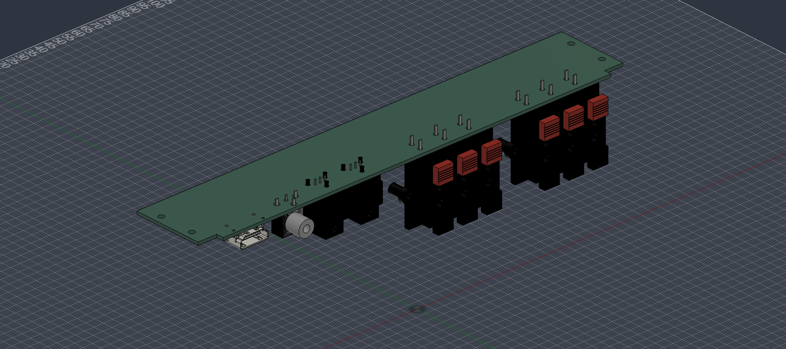

# Open Cinema Hardware

Editable hardware for [Open Cinema](https://github.com/k3rnL/open-cinema). The [resources repository](https://github.com/k3rnL/open-cinema-resources) holds searchable knowledge and decision history.

## Current HDMI scope: ARC first

The owner selected ARC on 2026-11-04, retaining DD+ Atmos payload transport and deferring eARC/lossless return audio. See the [ARC implementation contract](docs/arc-v1-requirements.md). This changes requirements; A10's HDMI socket remains unwired and no revised model or ARC functionality is claimed.

## A10: electrical draft in a separate project

[Start with A10](boards/rear-io-A10/README.md): editable schematic, chip sourcing, two static review passes and rigid STEP/F3D exports. Optical/coax selection and LVDS circuitry are drafted. **HDMI/eARC is unresolved, the PCB is unrouted, and this is not ready to order.** A9 below remains the historical mechanical baseline; its manually modified project file is preserved.

## A9: horizontal PCB and connectors only

All six speaker pairs, two optical receivers, coaxial RCA and HDMI are directly soldered to one horizontal PCB. The board sits above the connectors with its component side facing downward, so the solder tails point upward. Optical daughterboards and their cradle are no longer needed.

**Fit study only:** the right-angle KLS speaker blocks have an unverified operating-current rating and purchase route. The recessed RCA needs a cable-fit check. Do not treat these as approved production parts or final plate cutouts.

## Files to use

- [Rigid Fusion assembly (.f3d)](boards/rear-io/exports/rear-io-A9-rigid.f3d)
- [Rigid STEP assembly](boards/rear-io/exports/rear-io-A9-rigid.step)
- [PCB and connectors only, oriented rigid STEP](boards/rear-io/exports/rear-io-A8-board-rigid.step)
- [Editable KiCad project](boards/rear-io/rear-io.kicad_pro)
- [Dimensions, connector references, sourcing, limitations and checks](docs/horizontal-assembly-A8.md)

The current export contains one component with **67 solid bodies: PCB and connectors only**. The backplate and both L brackets have been removed; the owner will design those. All four Ø3 PCB mounting holes remain at x±110 mm, 12/30 mm inward. The old vertical plate-reference holes belong to the owner’s mechanical parts and are no longer represented by added support solids. See the [A9 change record](docs/pcb-only-assembly-A9.md).

The PCB is nominally 228 ×39.8 ×1.6 mm. The connector seating surface is z67 mm above the enclosure floor. KiCad DRC passes with zero violations. Copies of the current rear frame and PSU show no modeled collision, with 2 mm minimum assembly-to-PSU clearance; this is not thermal or tolerance qualification. The temporary fit test used copies; the subsequent authorized live integration is recorded below.

## Candidate parts

| Qty | Interface | Reference |
| --- | --- | --- |
| 2 | Three speaker pairs per block | KLS **L-KLS1-WP-6P-03B-B/R** — current rating and supply unresolved |
| 2 | Optical | Cliff **FCR684205R**, directly on the main PCB |
| 1 | Coaxial RCA | Same Sky **RCJ-011**, JLC C4992678 |
| 1 | HDMI A | Amphenol **10029449-001RLF**, JLC C428493 listing; stock unconfirmed |

JLCPCB remains preferred; pre-order/Global Sourcing and external suppliers are allowed. The BOM is not order-ready. A connector does not establish ARC/eARC support. No schematic, nets, routing, decoding, LVDS or speaker-current distribution has been added; keep mains separate and preserve independent speaker returns.

## History and reproducibility

A7's vertical FE6930 design and exports remain available in [Git history](https://github.com/k3rnL/open-cinema-hardware/tree/eae54aa79c94255bdad5aaae5bf087d2b4166b0e). Older generators must not be run over current manual edits. A8 sources, rebuild instructions and check evidence are linked in [the A8 record](docs/horizontal-assembly-A8.md).

No project hardware license has been selected. Redistributed KiCad library assets retain their [attribution and license](docs/sources/README.md).

Fusion cloud status: the open linked source shows A9 (PCB and connectors only), but its save remains pending at v2. Parent v3 and Home Cinema v8 saved. See the [integration status](docs/pcb-only-assembly-A9.md#fusion-status) before reopening or replacing cloud files.
