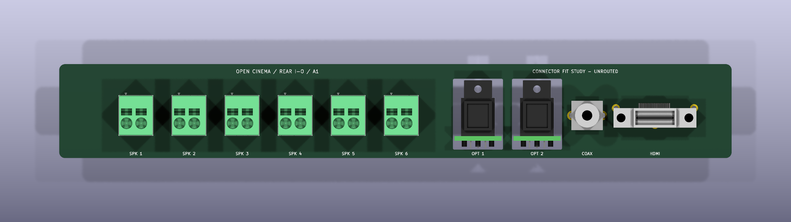

# Open Cinema Hardware

Editable hardware for [Open Cinema](https://github.com/k3rnL/open-cinema).
The [resources repository](https://github.com/k3rnL/open-cinema-resources) holds the searchable reference book and project history.

## Rear connector assembly — A1

Open [rear-io.kicad_pro](boards/rear-io/rear-io.kicad_pro) in **KiCad 10** (checked with 10.0.5).
The main PCB remains **vertical, 228 × 32 × 1.6 mm**. Two small horizontal optical daughterboards pass through clearance windows in it. Each has its own [editable KiCad project](boards/optical-input/optical-input.kicad_pro).

| Qty | Interface | Selected reference |
| --- | --- | --- |
| 6 | Two-pole speaker spring terminal | Phoenix Contact **1732496**, SPT 2,5/ 2-V-5,0-EX |
| 2 | Optical receiver, one per daughterboard | Cliff **FCR684205R / ORJ5** |
| 1 | Coaxial S/PDIF RCA socket | Same Sky **RCJ-021** |
| 1 | Vertical HDMI Type A socket | Amphenol FCI **10078837-001LF** |

[Parts, sources and footprint/model provenance](docs/connector-selection-A1.md).
The speaker terminals are green industrial spring terminals; they are not red/black consumer speaker clips.

Real connector pads replace the A0 envelopes. J7/J8 on the main board represent the optical assemblies mechanically; their receiver solder pads are in the daughterboard project. The Phoenix model comes from KiCad; the other STEP models were reconstructed from manufacturer drawings and have simplified cosmetic details.

**Mechanical integration study, not a fabrication release.** There are no circuit nets, tracks, schematic, logic or LVDS electronics. Daughterboard support/wiring, plate cutouts and PCB setback remain undecided. The two owner-supplied Ø3 fixing locations are reference graphics only, with no PCB drills.

## Integration files

- [Assembly STEP for Fusion](boards/rear-io/exports/rear-io-A1-assembly.step)
- [PCB-only STEP](boards/rear-io/exports/rear-io-A1-board-only.step)
- [PCB perimeter and optical windows — DXF](boards/rear-io/exports/rear-io-A1-outline.dxf)
- [Angled assembly view](boards/rear-io/exports/rear-io-A1-oblique.png)
- [Placement drawing — SVG](boards/rear-io/exports/rear-io-A1-layout.svg)
- [Geometry, coordinates and remaining fit work](docs/rear-io-mechanical.md)
- [Verification and limits](docs/verification-A1.md)
- [Owner's sketch evidence](mechanical/reference/README.md)

A0 exports remain as historical evidence; [A0 notes](docs/rear-io-mechanical-A0.md) describe the superseded placeholder study. Use **A1** for current integration.

## Working on the project

Keep this checkout beside `open-cinema-resources` in `Documents/Open Cinema`.
Use its `open-cinema-memory` skill for context retrieval and recording decisions.
Project-relative footprint/model libraries travel with both KiCad projects.
`tools/check_connectors.py` checks saved A1 geometry; `tools/export_review.py` exports it without regeneration. Run them with KiCad's Python/CLI respectively. `tools/generate_connectors.py` explicitly rebuilds the study and must not overwrite later manual edits. See [verification](docs/verification-A1.md).

## License

No project hardware license has been selected. Rights remain with contributors.
The included Phoenix footprint derivative and 3D model are KiCad library material; see [attribution and library license](docs/sources/README.md).
