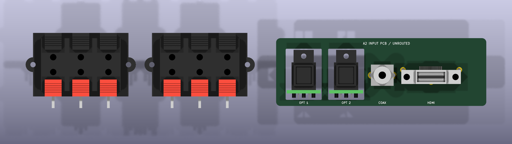

# Open Cinema Hardware

Editable hardware for [Open Cinema](https://github.com/k3rnL/open-cinema). The [resources repository](https://github.com/k3rnL/open-cinema-resources) owns searchable knowledge and decision history.

## Rear connector fit study — A2

The speaker connectors now use **conventional red/black finger-operated clips**. The owner rejected A1's industrial terminals and allowed a taller opening.

- **Two KLS L-KLS1-WP-6P-03B-B/R blocks**, six contacts each: twelve independent contacts / six speaker pairs. These are mechanical candidates; the manufacturer's inspected drawing does not specify operating current. Do not order them as electrically qualified parts yet.
- **210 × 35 mm R5 opening**, enlarged upward in the fit study. The actual Fusion frame is unchanged. Its upper fixing holes conflict with the taller opening and need redesign.
- **99 × 32 × 1.6 mm vertical input PCB**, beside the speaker blocks, with the existing two optical daughterboards, RCA and HDMI. Speaker blocks attach to the connection plate; insulated wires to the amplifier are proposed. Supports and wiring are not designed.

Open [rear-io.kicad_pro](boards/rear-io/rear-io.kicad_pro) in KiCad 10. The speaker assembly footprints are mechanical references with drawing-derived STEP models, **not solder footprints on the input board**. The optical receiver solder footprints remain in [optical-input](boards/optical-input).

| Qty | Interface | Reference / status |
| --- | --- | --- |
| 2 | Six-contact red/black speaker block | **L-KLS1-WP-6P-03B-B/R** — mechanical candidate |
| 2 | Optical receiver, one per daughterboard | Cliff **FCR684205R / ORJ5** |
| 1 | Coaxial S/PDIF RCA | Same Sky **RCJ-021** |
| 1 | Vertical HDMI Type A | Amphenol FCI **10078837-001LF** |

[Speaker references and unresolved qualifications](docs/speaker-clips-correction.md) · [Audio input source drawings](docs/connector-selection-A1.md).

## Integration files

- [A2 assembly STEP for Fusion](boards/rear-io/exports/rear-io-A2-assembly.step)
- [A2 PCB-only STEP](boards/rear-io/exports/rear-io-A2-board-only.step)
- [A2 PCB outline DXF](boards/rear-io/exports/rear-io-A2-outline.dxf)
- [A2 placement SVG](boards/rear-io/exports/rear-io-A2-layout.svg)
- [A2 angled view](boards/rear-io/exports/rear-io-A2-oblique.png)
- [Mechanical coordinates and fit limitations](docs/rear-io-mechanical.md)
- [Verification and exact source hashes](docs/verification-A2.md)

**Placement study only.** No circuit nets, tracks, schematic, decoding or LVDS. Current rating, plate apertures/setback, attachment, insulation and service access require validation. Speaker tails extend below the opening; their clearance to the frame and PSU is unresolved. Owner Ø3 fixing references remain graphics only.

A0/A1 exports and source history are preserved. A1 speaker terminals are rejected and must not be ordered for this design. [A1 mechanical history](docs/rear-io-mechanical-A1.md).

## Working on the project

Keep this checkout beside `open-cinema-resources` in `Documents/Open Cinema`; use its memory skill. All models resolve through project-relative paths.

`tools/check_connectors_A2.py` checks saved geometry and DRC evidence. `tools/export_review.py` exports the saved A2 board. `tools/revise_speaker_clips.py --rebuild` explicitly rebuilds this fit study using saved input footprints; do not run it over manual design edits. Historical A1 generators/exporters require explicit historical flags.

## License

No project hardware license has been selected. Rights remain with contributors. Historical Phoenix files retain their [KiCad library attribution](docs/sources/README.md). New KLS STEP geometry is project-authored from the cited drawing; it is not vendor CAD.
