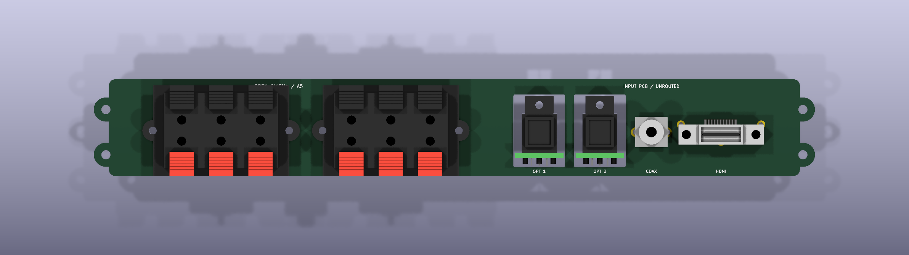

# Open Cinema Hardware

Editable hardware for [Open Cinema](https://github.com/k3rnL/open-cinema). The [resources repository](https://github.com/k3rnL/open-cinema-resources) owns searchable knowledge and decision history.

## Rear connector fit study — A5

The owner rejected A2's downward speaker pins because they approach the PSU. A3 uses **straight rear-facing terminals through the vertical PCB**, with the owner's updated **220 × 35 mm R5 opening**. Surface-mount construction is not required to achieve this direction.

| Qty | Interface | Reference / status |
| --- | --- | --- |
| 2 | Six-contact red/black speaker block | **Dragon City PT-603B** — mechanical candidate; current rating and small-quantity supply unconfirmed |
| 2 | Optical receiver, each on a small horizontal daughterboard | Cliff **FCR684205R / ORJ5** |
| 1 | Coaxial S/PDIF RCA | Same Sky **RCJ-021** |
| 1 | Vertical HDMI Type A | Amphenol FCI **10078837-001LF** |

Open [rear-io.kicad_pro](boards/rear-io/rear-io.kicad_pro) in KiCad 10. The **228 × 32 × 1.6 mm vertical PCB body**, now with four small alignment tabs, two per side (238 mm overall width), carries twelve provisional speaker pads, RCA and HDMI. Optical assembly instances point to the separate [optical daughterboards](boards/optical-input). Speaker STEP models are project reconstructions from the manufacturer drawing, not vendor CAD.

[Speaker selection, drawing and assumptions](docs/connector-selection-A3.md) · [Audio-input sources](docs/connector-selection-A1.md).

## Integration files

- [A5 assembly STEP for Fusion](boards/rear-io/exports/rear-io-A5-assembly.step)
- [A5 PCB-only STEP](boards/rear-io/exports/rear-io-A5-board-only.step)
- [A5 PCB outline DXF](boards/rear-io/exports/rear-io-A5-outline.dxf)
- [A5 layout SVG](boards/rear-io/exports/rear-io-A5-layout.svg)
- [A5 exterior view](boards/rear-io/exports/rear-io-A5-front.png)
- [Mechanical coordinates and fit limits](docs/rear-io-mechanical.md)
- [Verification and source hashes](docs/verification-A5.md)

**Placement study only.** No nets, tracks, schematic, decoding, LVDS or speaker-current distribution. Manufacturer current rating, supply, sample dimensions, final drills, support, connection-plate apertures and full enclosure clearance need qualification before purchase or fabrication. Both sides now have real **Ø3 mm non-plated holes**, four total at x±115,z44/59, to align the STEP model with the plate. They are provisional mounting geometry; the four speaker-component holes are separate.

A0–A4 exports remain historical. A1 industrial terminals and A2 downward-tail speaker blocks are rejected. [A2 mechanical history](docs/rear-io-mechanical-A2.md).

## Working on the project

Keep this checkout beside `open-cinema-resources` in `Documents/Open Cinema`; use its memory skill. All models resolve through project-relative paths.

`tools/check_connectors_A5.py` checks saved geometry and native DRC evidence. `tools/export_review.py` exports the saved A5 board. `tools/mirror_alignment_holes_A5.py --apply` adds the right alignment pair to an A4 board while preserving connector footprints; do not run historical rebuilds over the current design. Older tools are historical and require explicit flags.

## License

No project hardware license has been selected. Rights remain with contributors. Historical Phoenix files retain their [KiCad attribution](docs/sources/README.md). Drawing-derived connector models are project-authored, not manufacturer-supplied CAD.
