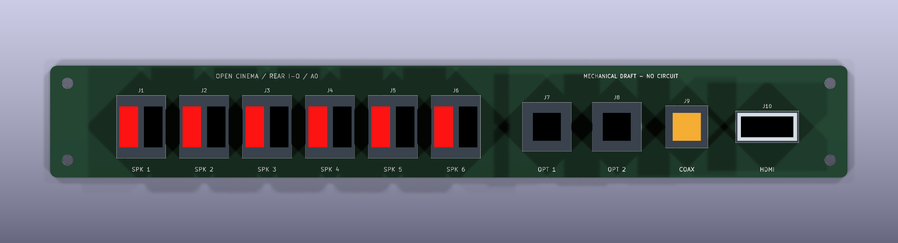

# Open Cinema Hardware

Editable hardware designs for [Open Cinema](https://github.com/k3rnL/open-cinema).
Project history, research and the searchable reference book remain in
[open-cinema-resources](https://github.com/k3rnL/open-cinema-resources).

## Rear connector board — A0 mechanical study

Open [rear-io.kicad_pro](boards/rear-io/rear-io.kicad_pro) in **KiCad 10**,
then open the PCB. The sources were generated and checked with KiCad **10.0.5**.

- Proposed vertical PCB: **228 × 32 mm**, nominal **1.6 mm**, R2 corners.
- Reference opening: **210 × 25 mm, R5**, measured from the owner's Fusion
  document `Rear Panel v4`, `Sketch2`, on 2026-11-03.
- Six speaker pairs (12 contacts), two optical inputs, one coaxial S/PDIF input,
  and one HDMI input for the future eARC/ARC circuitry.
- Four proposed 3.2 mm PCB mounting holes, separate from the rear frame fixings.
- Connector positions are editable KiCad footprints with labelled 3D envelopes.

**This is a fit study, not a functional or fabrication-ready PCB.** Connector
envelopes are deliberately padless placeholders, not verified commercial parts.
Their dimensions and the common 20 mm depth are design allowances. They cannot
be used to order connectors or cut the connection plate. No logic, LVDS circuits,
signal pads, nets, tracks, copper pours, schematic or fabrication outputs exist.

## Use in Fusion

- [PCB and connector envelopes — STEP](boards/rear-io/exports/rear-io-A0-envelopes.step)
- [PCB only — STEP](boards/rear-io/exports/rear-io-A0-board-only.step)
- [Board outline — DXF](boards/rear-io/exports/rear-io-A0-outline.dxf)
- [Placement drawing — SVG](boards/rear-io/exports/rear-io-A0-layout.svg)
- [Geometry and integration notes](docs/rear-io-mechanical.md)
- [Checks and limitations](docs/verification-A0.md)

The STEP assembly was imported into a temporary Fusion document to check solid
geometry. It has not been fitted into or checked for interference with the full
enclosure. The owner's original Fusion document was left unchanged.

## Repository map

| Location | Purpose |
| --- | --- |
| `boards/rear-io/` | KiCad project, editable PCB, local footprint/model library, placement parameters and exports |
| `mechanical/reference/` | Owner screenshots and read-only extraction of the rear-panel sketch |
| `docs/` | Fit assumptions, coordinate systems and verification |
| `tools/` | Initial study generator and geometry checker |

Keep this checkout beside `open-cinema-resources` in `Documents/Open Cinema`.
Use the memory skill in the resources repository for retrieving or recording
project knowledge. Keep future editable PCB work here and link it from memory.

## License

No hardware license has been selected. Rights remain with the contributors.
