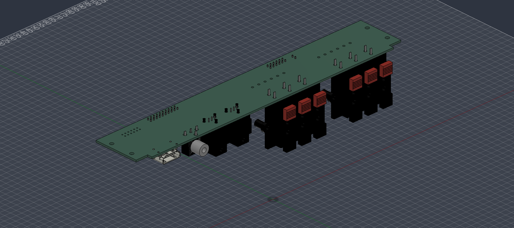

# A10 electrical draft — not for fabrication

This is a new, separate KiCad project. A9 and its manually modified project file are preserved.
The owner authorized chip research, schematic work, two reviews and an integration export.

Implemented: two optical receivers and coax into a CS8416K; selection between that receiver and a future normalized eARC interface; six LVDS transmit pairs; Pi control connections; 5 V-to-3.3 V power; six independent speaker pairs and amplifier wire solder pads.

**HDMI extraction is not implemented.** The existing HDMI socket is only mechanical. Public SiI9437 and EP92H1 documentation is insufficient to implement the required eARC/ARC/HBR/MAT circuit. The J23 header is a provisional 3.3 V test interface, not a real module pinout. No Pi HAT is included.

## Open these files

- [KiCad project](rear-io-A10.kicad_pro) and [schematic](rear-io-A10.kicad_sch)
- [PCB placement](rear-io-A10.kicad_pcb): four layers, no tracks or planes yet
- [Rigid Fusion archive](exports/rear-io-A10-rigid.f3d) / [rigid STEP](exports/rear-io-A10-rigid.step)
- [Sourcing](sourcing.md), [requirements](requirements.md), [two review passes](verification.md)
- [Draft BOM](bom-draft.csv): TBD and provisional entries are deliberately not orderable
- [Schematic preview](exports/rear-io-A10.svg); follow the four editable child sheets in KiCad

The rigid exports contain **114 solid bodies in one component, zero child components**. Both were reimported and compared with the source export. Disable Ground to Parent if Fusion prevents the intended assembly joint. This is a local export; no cloud component was replaced.

The A9 outline and all four Ø3 mounting holes are retained: 228 × 39.8 × 1.6 mm nominal PCB, x ±110 mm, depths 12/30 mm. Component face is downward at the previous nominal z 67 mm datum; no backplate or L brackets are included. In the STEP coordinate system, depth is negative Y, rear plate datum Y=0, and X follows the previous installed export. The bare FR4 solid excludes copper/mask thickness; component seating remains the previous datum.

The owner enlarged the rear opening to 250 × 51 mm. This draft does not freeze the new installed Y position, cable bends, shield clearance or PSU airflow. It retains the footprint size to avoid silently moving alignment holes. A 29 × 13 mm unoccupied region is reserved near HDMI for planning only; it does not establish that a complete eARC implementation fits. The imported model must be checked in the enlarged enclosure before modifying metalwork.

## Reproduce

With KiCad 10.0.5 Python and CLI, run `tools/build_electrical_A10.py --output <new-folder> --source <repository-root>`. Do not regenerate over manual edits. Export KiCad XML netlist, JSON ERC and DRC into a reports folder; run `tools/review_electrical_A10.py --board-dir <new-folder> --reports <reports-folder>`. The review expects filenames `netlist.xml`, `erc.json`, `drc.json`.

Export STEP with drill origin, model substitution and DNP exclusion. The Fusion script `tools/export_electrical_A10_fusion.py` accepts RAW, OUT and BOARD variables and uses temporary documents only. It flattens bodies and applies the A9 installation rotation. A10 models reuse historical connector assets and add KiCad package models; see [attribution](../../docs/sources/README.md).
