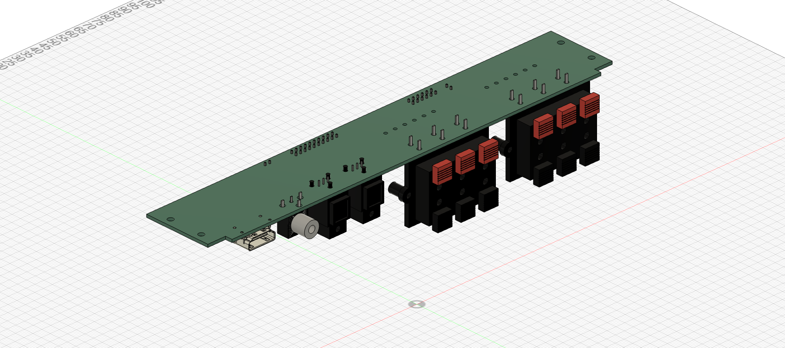

# Rear I/O A11 — ARC electrical study

2026-11-04. **Unrouted prototype draft; not ready for manufacture or ordering.**

A11 adds an ADV7511 ARC candidate to the existing horizontal connector board. It feeds a fourth CS8416 input alongside two optical inputs and coax. The CS8416 selects the source, then sends BCLK, LRCLK and one data lane through a single LVDS driver. The Pi owns CEC/source control, decoding and DSP; processed sound leaves by USB to the amplifier.

## Open these files

- [KiCad project](rear-io-A11.kicad_pro), [root schematic](rear-io-A11.kicad_sch) and [PCB placement](rear-io-A11.kicad_pcb).
- [Schematic PDF](exports/rear-io-A11-schematic.pdf) and [individual SVG sheets](exports/rear-io-A11.svg).
- [Rigid STEP](exports/rear-io-A11-rigid.step) or [Fusion archive](exports/rear-io-A11-rigid.f3d) for enclosure integration.
- [Requirements and interface contract](requirements.md), [part sourcing](sourcing.md), [two-pass verification](verification.md), [source register](source-register.json), [draft BOM](bom-draft.csv).

## What changed

ADV7511KSTZ has public pin, electrical and programming documentation. Its ARC support circuit, CEC clock, supply filters, HDMI protection and switchable HDMI 5 V are included. This is a project-selected **test candidate**, not proof of DD+ Atmos compatibility. ADI also states an HDMI-adopter purchasing condition; a JLC listing does not establish eligibility.

A10's two logic muxes, second LVDS transmitter and provisional eARC input header are removed. CS8416 now selects all four sources internally. J22 retains the old pair positions but uses only three pairs; J20 pins 7 and 8 change function. Consult the interface contract before connecting a HAT.

The 228 × 39.8 mm outline, all connector positions and four Ø3 mm PCB holes are preserved. Nominal component placement fits one board; routing feasibility and the enlarged enclosure remain to be verified. Decouplers are a space allocation, not completed placement for routing. Mains inlet, owner backplate and L brackets are separate.

## Fusion use

The rigid files contain **one component, 161 solid bodies, no child components**. They are already in the previous installation coordinates, component side down at nominal z 67 mm. Insert the complete component and joint a PCB mounting hole; disable Ground to Parent if necessary. STEP is an exchange copy, not a live link to KiCad.

The linked `rear-io-A5-assembly v2` had unsaved edits at inspection. A11 was exported and checked in temporary documents; it was **not pushed into or saved over that Fusion document**. These files are the new integration deliverable. Its cloud version remains unchanged by this session.

## Release gates

DD+ carrier bandwidth and payload/JOC preservation, ARC-only startup without a video clock, CEC interoperability, Pi capture/HAT timing, actual power/thermal/EMI behavior, final routing/protection and speaker-terminal current qualification remain open. Exact supplier acceptance and several passive/header selections also remain open. No order was placed.

A10 and A9 remain in their original directories. Do not regenerate over manual changes. [Reproduction commands and evidence](verification.md).
