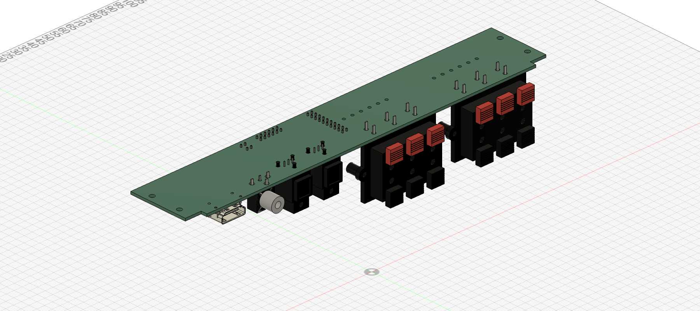

# Rear I/O A12 — routed ARC prototype

2026-11-04. **Routing complete; manufacturing release on hold for qualification.**

A12 routes the ADV7511 ARC candidate, CS8416 four-source selector and three-pair LVDS transmitter. Audio decoding and processing remain on the Pi, with USB output to the amplifier. It adds a TPD1E10B06DYAR coaxial ESD clamp and completes the passive/header reference selections. This is an editable prototype, not a demonstrated ARC/DD+ product.

- [KiCad project](rear-io-A12.kicad_pro), [schematic](rear-io-A12.kicad_sch), [routed PCB](rear-io-A12.kicad_pcb).
- [Schematic PDF](exports/rear-io-A12-schematic.pdf), [front copper](exports/routing-front.svg), [back copper](exports/routing-back.svg).
- [Rigid STEP](exports/rear-io-A12-rigid.step) / [Fusion archive](exports/rear-io-A12-rigid.f3d) for enclosure integration.
- [Manufacturing review package](manufacturing-review/README.md), [requirements](requirements.md), [sourcing](sourcing.md), [verification](verification.md), [bring-up and release gates](bring-up.md).

## Routing and checks

Four copper layers: signal/power on both outer layers, continuous inner ground in the electronics region, plus outer ground fills and thermal/return vias. All 12 BTL speaker conductors have independent 2.5 mm paths on both outer layers with through-hole endpoints and no intervening vias. No speaker negative is tied to ground.

Final KiCad checks: **0 ERC violations, 0 DRC violations, 0 unrouted connections**. Separate schematic and board review passes check 423 electrical pad keys, 98 footprints and 92 resolved model links. These are static checks by one assistant, not independent engineer approval or powered testing. [Exact results and hashes](exports/review-two-passes.json).

The 228 × 39.8 × 1.6 mm outline, external connector positions and four Ø3 mounting holes remain unchanged from A9. The 250 × 51 mm owner opening still needs an assembled clearance/airflow check. No backplate, L brackets or mains circuit is included.

## Fusion integration

The STEP and F3D each contain **one component with 162 solid bodies and no child components**. Both reimports match their exported geometry. They use the previous component-down installation datum, nominal seating z 67 mm. Insert the entire component and joint a PCB mounting hole; disable Ground to Parent if needed. These files are separate integration exports. The existing linked Fusion cloud component and the owner's enclosure were not overwritten or saved.

## Why ordering remains on hold

ADV7511 procurement eligibility and ARC-only/DD+ operation remain unresolved. CEC firmware, Pi HAT/capture, speaker-clip current rating/supply, thermal/EMI/ESD behavior and assembled tolerances need qualification. Some CAD is generic library geometry or project reconstruction; it is not a guarantee of vendor tolerances. The Gerbers/BOM/CPL are supplied for engineering and supplier review, with an explicit hold notice. No supplier was contacted and no order was placed.

A11 remains historical. The routed PCB is the editable layout authority; do not rerun the A11 placement generator over it. See [reproduction instructions](verification.md).
