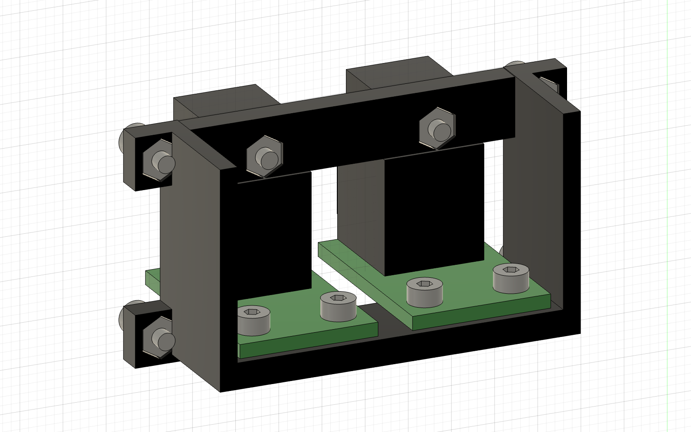

# A7 integration and optical mounting

2026-11-03 · millimetres · mechanical prototype, not a production release.

## Fusion: import the rigid companion file

Use [rear-io-A7-rigid.f3d](../boards/rear-io/exports/rear-io-A7-rigid.f3d), or [rear-io-A7-rigid.step](../boards/rear-io/exports/rear-io-A7-rigid.step). Both contain **one component with 135 solid bodies**. The raw KiCad `rear-io-A7-assembly.step` deliberately retains the separate component hierarchy and is not the enclosure-placement deliverable.

1. Open the rigid file, save it as a Fusion design, then insert that design into the enclosure.
2. Select the inserted occurrence in the Browser. If **Ground to Parent** or **Ground** is enabled, disable it for this inserted unit. Keep the enclosure fixed.
3. Create a **Rigid Joint**, selecting the circular edge of a PCB alignment hole and its matching plate hole. Use joint orientation/angle controls to align the second hole rather than relying on one circle to define the rotation by itself.
4. Check the other three holes. They remain Ø3 at x±115, z44/59. An unexpected flip is a joint orientation issue, not a different hole spacing.

The original hierarchical export contained independent, unconstrained components. A joint to its PCB could therefore move only the PCB. The new file resolves this with component structure; it does not pretend that STEP stores Fusion rigid-group constraints. Select the component when using Move, not a single body. The temporary validation assembly used a joint from HREF1 and verified that all 135 bodies followed the same transformation. The owner's working Fusion document was not edited or saved.

## Optical support

A shared **OC-OPTICAL-CRADLE-A6** holds the existing two Cliff FCR684205R receivers and their horizontal PCBs. The vertical main board is retained. A7 translates the complete A6 cradle and optical group 4 mm right; the cradle part and child-board shapes are unchanged.

- Four M2 screws attach the cradle to the main PCB at x20/64, z42/62. The new main-board clearance holes are Ø2.2, separate from the four owner alignment holes.
- Two M2 screws through each optical PCB attach its rear edge to the lower shelf. Local hole centres are x±5, y12 relative to the receiver pin-row origin, with Ø2.2 drills.
- Each receiver's existing Ø2.5 mounting lug is bolted to the upper bridge. This gives plug push/pull forces a path through the molded socket lug, cradle and carrier, rather than relying on electrical leads or an unsupported board.
- The lower shelf supports the PCB underside at z42.9. PCB top is z44.5. Hexagonal recesses hold M2 nuts; printed bores are Ø2.4 and nut pockets4.3 across flats,1.8 deep. These allowances need a physical fit coupon.
- Main-board screws: **4 × M2×6**; daughterboard screws: **4 × M2×6**; receiver lug screws: **2 × M2×14**; nuts: **10 × M2**, nominal4 mm across flats,1.6mm thick. Screw envelopes use ISO4762-style Ø3.8×2 heads; threads and tolerances are not modeled. Verify the chosen screw/nut drawing before buying.

The cradle is a **project-designed insulating polymer prototype**, intended for a separate [JLC3DP PA12 quote](https://jlc3dp.com/blog/functional-3d-printing), not a stocked PCBA part. Editable generation source, [cradle STEP](../boards/rear-io/models/optical-cradle-A6.step) and [STL](../boards/rear-io/models/optical-cradle-A6.stl) are included. JLC3DP is a separate mechanical service; a JLCPCB assembly order does not include the cradle or final screw assembly automatically. Outside mechanical suppliers are also allowed under the owner's latest sourcing instruction.

Assembly order: insert nuts, loosely bolt the cradle to the carrier, fit populated optical boards through the carrier windows, loosely install the four board screws and two lug screws, align the sockets, then snug the screws without deforming the plastic. Do not tighten against incompatible board/lug spacing. Electrical wiring and connector selection for the daughterboards remain deferred.

## Verified scope and remaining fit work

Fusion reports no positive-volume intersection between the cradle and the modeled connector assembly. This is a nominal geometry check, not a load test. The cradle spans x17…67, z39…65 and extends16.85mm into the enclosure from the main PCB front. The lowest modeled screw end is z38.5; that is5.5mm above the old PSU-top line33 in projection only. The user's final enclosure/PSU placement, connection-plate setback, plug access, thermal behaviour and tolerance stack still need checking together.

The narrow right-side gap near the RCA tail is approximately 0.4 mm in this nominal reconstruction. Do not release the cradle before checking real parts and manufacturing tolerances. PA12 suitability at the measured operating temperature, stiffness under cable loads, printed-hole fit and nut retention are unqualified. This support is not a certified mains barrier. The carrier's final attachment to the connection plate also remains undecided.

Connector circuitry, decoupling, daughterboard harness, LVDS and amplifier wiring are still outside this mechanical revision. J7/J8 and CRADLE1 in the main PCB are mechanical assemblies, not components to place twice in an electrical BOM.
